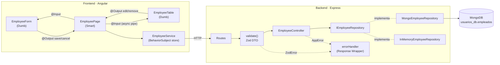

# Gestión de Empleados — Stack MEAN con Patrones de Diseño de APIs

**Maestría de Software · Patrones de Diseño de APIs · Práctica 03 (Stack MEAN)**

Refactorización de un CRUD de Gestión de Personal (MongoDB, Express, Angular, Node.js sobre TypeScript) que partía de un código base con **deuda técnica intencional**. El objetivo fue transformar un sistema acoplado y mutable en una arquitectura **desacoplada, validada, reactiva y modular**, alineada con los atributos de calidad del estándar **ISO/IEC 25010**.

---

## Tabla de contenidos

- [Tecnologías](#tecnologías)
- [Arquitectura](#arquitectura)
- [Estructura del proyecto](#estructura-del-proyecto)
- [Reto 1 — Patrón Repository](#reto-1--desacoplamiento-del-backend-y-persistencia-inversa)
- [Reto 2 — Validación DTO y Respuesta Universal](#reto-2--validación-perimetral-dto-y-respuesta-universal)
- [Reto 3 — Programación Reactiva e Inmutabilidad](#reto-3--programación-reactiva-e-inmutabilidad-en-el-servicio)
- [Reto 4 — Componentes Smart vs. Dumb](#reto-4--arquitectura-de-componentes-smart-vs-dumb)
- [Contrato de la API](#contrato-de-la-api)
- [Instalación y ejecución](#instalación-y-ejecución)
- [Pruebas](#pruebas-de-contrato)
- [Cumplimiento de la rúbrica](#cumplimiento-de-la-rúbrica)

---

## Tecnologías

| Capa | Tecnología |
|---|---|
| Base de datos | MongoDB + Mongoose 9 |
| Backend | Node.js 20+, Express 5, TypeScript, `tsx` (hot reload) |
| Validación | Zod |
| Frontend | Angular 17 (módulos + SSR), RxJS 7 |
| Pruebas de contrato | REST Client (VS Code) |

---

## Arquitectura



---

## Estructura del proyecto

### Backend (`code/backend/src`)

```
src/
├── index.ts                                  # Composition Root + registro de middlewares
├── config/
│   └── database.ts                           # Conexión a MongoDB
├── domain/
│   └── employee.ts                           # Entidad de dominio (sin dependencias)
├── repositories/
│   ├── employee.repository.ts                # Interfaz IEmployeeRepository (contrato)
│   ├── mongo-employee.repository.ts          # Implementación con Mongoose
│   └── in-memory-employee.repository.ts      # Implementación en memoria
├── models/
│   └── employee.model.ts                     # Schema de Mongoose
├── dtos/
│   └── employee.dto.ts                       # Esquemas Zod (body y params)
├── middlewares/
│   ├── validate.middleware.ts                # Validación perimetral
│   └── error-handler.middleware.ts           # Interceptor global de errores + 404
├── errors/
│   └── app-error.ts                          # AppError / NotFoundError
├── utils/
│   └── api-response.ts                       # Response Wrapper (sendSuccess / sendError)
├── controllers/
│   └── employee.controller.ts                # Controlador agnóstico al ODM
└── routes/
    └── employee.routes.ts                    # Fábrica de rutas
```

### Frontend (`maestria/src/app`)

```
app/
├── app.module.ts
├── app.component.html                        # <app-employee-page>
├── components/
│   ├── employee-page/                        # SMART  · orquestador
│   ├── employee-form/                        # DUMB   · formulario
│   └── employee-table/                       # DUMB   · tabla
├── models/
│   ├── employee.ts
│   └── api-response.ts
└── services/
    └── employee.service.ts                   # Store reactivo (RxJS)
```

---

## Reto 1 — Desacoplamiento del Backend y Persistencia Inversa

### Problema en la base
El controlador importaba e instanciaba directamente el modelo de Mongoose, acoplando la capa HTTP con el motor de base de datos.

### Solución: Patrón Repository + Inyección de Dependencias
- **Contrato abstracto** `IEmployeeRepository` con las 5 operaciones: `findAll`, `findById`, `create`, `update` y `delete`.
- **`MongoEmployeeRepository`** es la única clase que conoce Mongoose. Además traduce `_id` → `id`, para que el detalle de Mongo no se filtre a otras capas.
- **`InMemoryEmployeeRepository`** es una implementación alternativa que demuestra que la persistencia es intercambiable.
- **`EmployeeController`** recibe la abstracción por constructor y no importa Mongoose.
- **Composition Root** (`index.ts`): es el único lugar donde se decide qué implementación concreta se inyecta.

```ts
// controllers/employee.controller.ts
export class EmployeeController {
  constructor(private readonly repository: IEmployeeRepository) {}
  // ...
}

// index.ts — Composition Root
const repository: IEmployeeRepository =
  process.env.DB_DRIVER === 'memory'
    ? new InMemoryEmployeeRepository()
    : new MongoEmployeeRepository();

app.use('/api/v1', employeeRoutes(new EmployeeController(repository)));
```

### Verificación
```powershell
# Ninguna importación de Mongoose en controladores ni rutas
Select-String -Path .\src\controllers\*, .\src\routes\* -Pattern "from 'mongoose'"

# El sistema funciona sin MongoDB, sin tocar el controlador
$env:DB_DRIVER="memory"; npm run dev
```

**Principio aplicado:** Inversión de Dependencias (SOLID). El controlador depende de una abstracción, no de una implementación concreta.

---

## Reto 2 — Validación Perimetral DTO y Respuesta Universal

### Problema en la base
No había validación en tiempo de ejecución, las respuestas tenían formatos asimétricos y se exponían excepciones crudas del sistema.

### Solución

**1. DTOs declarativos con Zod** (`dtos/employee.dto.ts`)
```ts
export const CreateEmployeeDto = z.object({
  nombre:       z.string().trim().min(3, 'El nombre debe tener al menos 3 caracteres').max(100),
  cargo:        z.string().trim().min(2, 'El cargo debe tener al menos 2 caracteres').max(100),
  departamento: z.string().trim().min(2, 'El departamento debe tener al menos 2 caracteres').max(100),
  sueldo:       z.number().positive('El sueldo debe ser mayor a 0'),
});
export const UpdateEmployeeDto  = CreateEmployeeDto.partial().refine(/* al menos un campo */);
export const EmployeeIdParamDto = z.object({ id: z.string().regex(/* ObjectId | UUID */) });
```

**2. Middleware de validación perimetral.** Rechaza la petición **antes** de llegar al controlador:
```ts
router.post('/employees', validate({ body: CreateEmployeeDto }), controller.create);
router.put('/employees/:id', validate({ params: EmployeeIdParamDto, body: UpdateEmployeeDto }), controller.update);
```

**3. Response Wrapper Pattern.** Toda respuesta comparte el mismo contrato:
```ts
interface ApiResponse<T> {
  success: boolean;
  message: string;
  data: T | null;
  errors?: { field: string; message: string }[];
  timestamp: string;
}
```

**4. Interceptor global de errores** (`error-handler.middleware.ts`)

| Error | Respuesta |
|---|---|
| `ZodError` | `400` con la lista de campos inválidos |
| `AppError` / `NotFoundError` | Su propio código HTTP (p. ej. `404`) |
| JSON mal formado | `400` controlado |
| Cualquier otro | `500` genérico; el detalle solo se registra en el servidor |

Gracias a Express 5, las excepciones de los controladores `async` llegan automáticamente al interceptor, sin necesidad de `try/catch`.

---

## Reto 3 — Programación Reactiva e Inmutabilidad en el Servicio

### Problema en la base
El estado vivía en arreglos mutables públicos y el componente hacía peticiones `HttpClient` y `.subscribe()` manuales.

### Solución: `EmployeeService` como store reactivo
- **Estado privado** en `BehaviorSubject`, expuesto como **`Observable$` de solo lectura** con `asObservable()`.
- **Mutaciones inmutables**: cada operación emite un **arreglo nuevo**.
- **Gestión de errores**: traduce el Response Wrapper del backend a mensajes para la vista (`errors$`).

```ts
private readonly employeesSubject = new BehaviorSubject<Employee[]>([]);
readonly employees$ = this.employeesSubject.asObservable();

// Crear     → [...current, created]
// Actualizar → current.map(e => e.id === id ? updated : e)
// Eliminar  → current.filter(e => e.id !== id)
```

Los componentes **no** usan `HttpClient` ni `.subscribe()`. La vista consume los flujos con el **`async` pipe**, que gestiona la suscripción y su liberación automáticamente.

### Verificación
```powershell
Select-String -Path .\src\app\components\**\*.ts -Pattern "\.subscribe\("   # sin resultados
```

---

## Reto 4 — Arquitectura de Componentes Smart vs. Dumb

### Problema en la base
Un único HTML monolítico mezclaba el formulario de captura con la rejilla de datos.

### Solución

| Componente | Tipo | Responsabilidad |
|---|---|---|
| `EmployeePageComponent` | **Smart** | Único que inyecta `EmployeeService`. Consume `employees$`, `loading$` y `errors$` con `async` pipe y orquesta los eventos |
| `EmployeeFormComponent` | **Dumb** | `@Input() employee`, `@Input() resetKey` · `@Output() save`, `@Output() cancel` |
| `EmployeeTableComponent` | **Dumb** | `@Input() employees`, `@Input() selectedId` · `@Output() edit`, `@Output() remove` |

```html
<!-- employee-page.component.html (Smart) -->
<app-employee-form
  [employee]="selected" [resetKey]="resetKey"
  (save)="onSave($event)" (cancel)="onCancel()">
</app-employee-form>

<app-employee-table
  [employees]="(employees$ | async) ?? []" [selectedId]="selected?.id ?? null"
  (edit)="onEdit($event)" (remove)="onRemove($event)">
</app-employee-table>
```

### Pureza e inmutabilidad
- Los componentes Dumb **no inyectan servicios** y usan `ChangeDetectionStrategy.OnPush`.
- El formulario **clona su entrada** en `ngOnChanges` y emite un objeto nuevo al guardar. Editar en el formulario **no modifica la fila de la tabla** hasta confirmar la actualización.

```ts
ngOnChanges(): void {
  this.model = this.employee ? this.cloneFrom(this.employee) : this.emptyModel();
}
```

---

## Contrato de la API

Base URL: `http://localhost:3000/api/v1`

| Método | Ruta | Descripción | Éxito |
|---|---|---|---|
| `GET` | `/employees` | Listar empleados | `200` |
| `GET` | `/employees/:id` | Consultar por ID | `200` |
| `POST` | `/employees` | Crear empleado | `201` |
| `PUT` | `/employees/:id` | Actualización parcial o total | `200` |
| `DELETE` | `/employees/:id` | Eliminar empleado | `200` |

**Respuesta exitosa**
```json
{
  "success": true,
  "message": "Empleado creado correctamente",
  "data": { "id": "665f...", "nombre": "Andrés Mendoza", "cargo": "Arquitecto de Software", "departamento": "Innovación", "sueldo": 4500 },
  "timestamp": "2026-10-15T18:00:00.000Z"
}
```

**Respuesta de error de validación**
```json
{
  "success": false,
  "message": "Datos de entrada inválidos",
  "data": null,
  "errors": [
    { "field": "nombre", "message": "El nombre debe tener al menos 3 caracteres" },
    { "field": "sueldo", "message": "El sueldo debe ser mayor a 0" }
  ],
  "timestamp": "2026-10-15T18:00:00.000Z"
}
```

---

## Instalación y ejecución

### Requisitos
- Node.js 20 o superior
- Angular CLI 17
- MongoDB en `mongodb://127.0.0.1:27017`

### Backend
```bash
cd code/backend
npm install
npm run dev            # http://localhost:3000
```

Para ejecutar **sin MongoDB**, usando el repositorio en memoria:
```powershell
$env:DB_DRIVER="memory"; npm run dev      # PowerShell
```
```bash
DB_DRIVER=memory npm run dev              # bash
```

### Frontend
```bash
cd maestria
npm install
ng serve               # http://localhost:4200
```

---

## Pruebas de contrato

Con la extensión **REST Client** de VS Code, crea un archivo `api.rest`:

```http
@baseUrl = http://localhost:3000/api/v1

### Creación válida → 201
# @name crear
POST {{baseUrl}}/employees
Content-Type: application/json

{ "nombre": "Andrés Mendoza", "cargo": "Arquitecto de Software", "departamento": "Innovación", "sueldo": 4500 }

###
@id = {{crear.response.body.data.id}}

### Inyección inválida → 400
POST {{baseUrl}}/employees
Content-Type: application/json

{ "nombre": "An", "cargo": "Developer", "departamento": "TI", "sueldo": -200 }

### Consultar por ID → 200
GET {{baseUrl}}/employees/{{id}}

### ID inexistente → 404
GET {{baseUrl}}/employees/650000000000000000000000

### Actualización parcial → 200
PUT {{baseUrl}}/employees/{{id}}
Content-Type: application/json

{ "sueldo": 5200 }

### Eliminar → 200
DELETE {{baseUrl}}/employees/{{id}}

### Ruta inexistente → 404
GET {{baseUrl}}/xyz
```

---

## Cumplimiento de la rúbrica

| Criterio | Peso | Evidencia |
|---|---|---|
| **Acoplamiento Cero** | 25% | El controlador no importa Mongoose; el repositorio se inyecta desde el Composition Root; el sistema funciona con `DB_DRIVER=memory` |
| **Gobernanza del Contrato** | 25% | Zod valida `body` y `params`; el Response Wrapper se aplica en éxitos y errores; el interceptor global no expone excepciones internas |
| **Flujo Reactivo Asíncrono** | 25% | `BehaviorSubject` privados, `Observable$` de solo lectura, mutaciones inmutables, `async` pipe y ninguna suscripción manual en componentes |
| **Separación de Vistas** | 25% | Un Smart y dos Dumb conectados solo por `@Input`/`@Output`, con `OnPush`; el formulario clona sus entradas |

### Alineación con ISO/IEC 25010

| Reto | Característica de calidad |
|---|---|
| 1 · Repository | Mantenibilidad: modularidad, modificabilidad, capacidad de prueba |
| 2 · DTO + Wrapper | Seguridad (integridad, confidencialidad) y fiabilidad (tolerancia a fallos) |
| 3 · Store reactivo | Mantenibilidad y eficiencia de desempeño |
| 4 · Smart / Dumb | Mantenibilidad: reusabilidad, analizabilidad, capacidad de prueba |

---

## Autor

**Héctor Moyón Amaya** — Maestría de Software
Docente: Ing. Patsy Prieto V., MSc.
